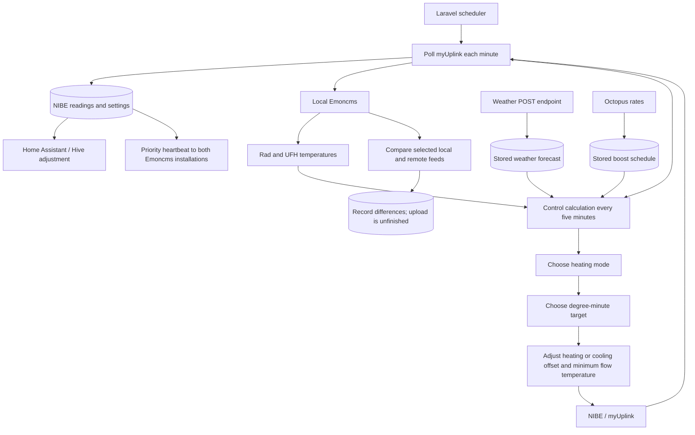

# Emoncms Helper

Emoncms Helper coordinates a NIBE heat pump, local and remote Emoncms installations, weather forecasts, Octopus electricity schedules, and a Hive thermostat through Home Assistant. Its main job is to decide how much space heating to encourage, then adjust NIBE's flow-temperature settings to steer its degree minutes toward a chosen target.

The heating levels in the code are `off`, `intermittent`, `on`, `boost`, and `extraBoost`. There is also a separate `cooling` mode. The lower running level is named **intermittent**, rather than intermediate.

This is a Laravel 10 / PHP application driven primarily by scheduled commands. The home page is the stock Laravel welcome page; there is no heating-control dashboard in this repository.

## Documentation

| Guide | Contents |
| --- | --- |
| [Heat pump control](docs/heat-pump-control.md) | Exact decision order, room-temperature bands, boosts, peak periods, defrost reduction, degree-minute calculations, cooling, and worked examples. |
| [Integrations and data](docs/integrations-and-data.md) | NIBE polling, Emoncms feeds, weather payloads, tariff schedules, Hive, hot water, database tables, and logging. |
| [Configuration and operation](docs/configuration-and-operation.md) | Environment variables and defaults, initial data requirements, command schedule, time zones, and troubleshooting. |
| [Implementation notes](docs/implementation-notes.md) | Disabled experiments, incomplete features, and edge cases that matter when interpreting the code. |

These guides describe the implementation initially reviewed on **17 October 2026**, starting from commit `287c794`, and updated on **18 October 2026** for independent radiator demand during UFH heating. Numerical examples use defaults from `config/`; an installation's `.env` or cached configuration can override them. The work traced application code, configuration, migrations, routes, email templates, and tests without querying the live database, inspecting secret configuration, or contacting connected services.

## How the pieces fit together



The controller combines indoor comfort with forecast conditions and time windows. Room-temperature thresholds move upward during boost windows and cold forecasts, and downward during the afternoon peak or a warm forecast. It then preserves an existing heating cycle, protects a cool UFH zone, applies a defrost-related cap, and finally checks for cooling.

The selected mode is a request made through temperature settings. The helper does not directly set compressor frequency, write the degree-minute value, or issue a compressor start/stop command. NIBE's own controls determine the physical response. `intermittent` permits more cycling by limiting the heating offset; `on` uses the same degree-minute target with more scope to maintain demand.

Radiator demand is recorded separately from the overall mode. During heating, Hive requests its on temperature only when the radiator temperature warrants intermittent heating or higher, using the same adjusted room thresholds. UFH-only demand can therefore run the heat pump while Hive keeps the radiator zone at its off target. Missing or stale decisions fall back to the existing priority-based behaviour; cooling is unchanged.

## Where to look in the source

| Location | Responsibility |
| --- | --- |
| `app/Http/Controllers/NibeController.php` | Main control loop, polling, target calculations, priority heartbeat, hot water, and offline detection. |
| `app/Http/Controllers/EmonController.php` | Feed comparison, indoor readings, and UFH temperature extrapolation. |
| `app/Http/Controllers/WeatherController.php` | Weather ingestion, forecast summaries, approximate dew point, and forecast publication. |
| `app/Http/Controllers/OctopusController.php` | Rate retrieval, window selection, schedule generation, and rates email. |
| `app/Http/Controllers/HomeAssistantController.php`, `app/Services/RadiatorHeatDemand.php` | Hive setpoint selected from NIBE priority and a fresh, separately recorded radiator-demand decision. |
| `app/APIs/` | HTTP adapters for the four external services and a shared Guzzle wrapper. |
| `app/Console/Kernel.php`, `app/Console/Commands/` | Timings and command entry points. |
| `app/Models/`, `database/migrations/` | Stored readings, mappings, settings, and logs. |
| `app/Services/ActivityLogSummarizer.php`, `app/Mail/`, `resources/views/emails/` | Administrator reports and notification formatting. |
| `routes/`, `resources/`, `public/`, `bootstrap/`, `app/Providers/` | Mostly Laravel scaffolding; the custom weather endpoint is in `routes/api.php`. |

## Getting started

See [configuration and operation](docs/configuration-and-operation.md) before enabling scheduled commands: several of them write to NIBE, Emoncms, Home Assistant, or send email. A fresh migration creates the database structure but does **not** populate the parameter catalogue, feed mappings, or initial token settings needed by the integrations.

The existing tests can be run with:

```text
php vendor/bin/phpunit
```

After the radiator-demand change, all **42 tests / 141 assertions** passed. Coverage includes zone-demand decisions and Hive targets with an isolated test database and mocked Home Assistant API, error-summary grouping, report rendering, and basic framework examples. These tests do not operate the physical equipment.
