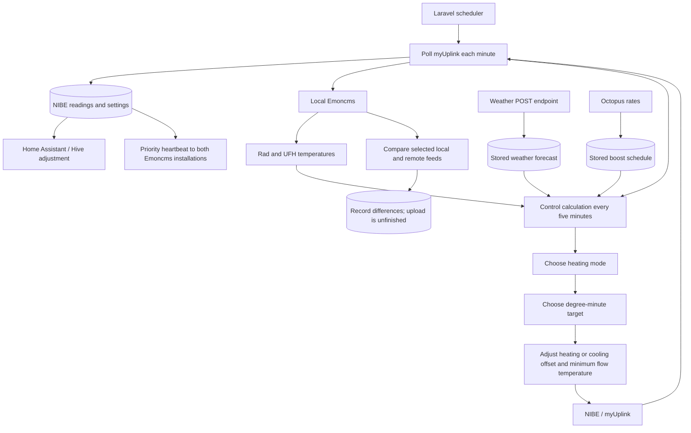

# Emoncms Helper

Emoncms Helper coordinates a NIBE heat pump, local and remote Emoncms installations, weather forecasts, Octopus electricity schedules, and a Hive thermostat through Home Assistant. Its main job is to decide how much space heating to encourage, then adjust NIBE's flow-temperature settings to steer its degree minutes toward a chosen target.

The heating levels in the code are `off`, `intermittent`, `on`, `boost`, and `extraBoost`. There is also a separate `cooling` mode. The lower running level is named **intermittent**, rather than intermediate.

This is a Laravel 10 / PHP application driven primarily by scheduled commands. Its authenticated web control panel provides an overview at `/` and editable operating settings at `/settings`. Credentials and connection details stay in environment configuration; operating parameters are stored separately in the existing settings table and read without a scheduler restart.

Activity and API Logs offer 100, 250, 500 or 1000 entries per page, defaulting to 250, with a bottom page-number control for jumping directly to older results while retaining the applied search.

## Documentation

| Guide | Contents |
| --- | --- |
| [Control panel and live settings](docs/control-panel.md) | First sign-in, importing existing values, live parameter editing, dashboard, searchable logs and saved searches. |
| [Heat pump control](docs/heat-pump-control.md) | Exact decision order, room-temperature bands, boosts, peak periods, defrost reduction, degree-minute calculations, cooling, and worked examples. |
| [Integrations and data](docs/integrations-and-data.md) | NIBE polling, Emoncms feeds, weather payloads, tariff schedules, Hive, hot water, database tables, and logging. |
| [Configuration and operation](docs/configuration-and-operation.md) | Environment variables and defaults, initial data requirements, command schedule, time zones, and troubleshooting. |
| [Implementation notes](docs/implementation-notes.md) | Disabled experiments, incomplete features, and edge cases that matter when interpreting the code. |

These guides describe the implementation initially reviewed on **17 October 2026**, starting from commit `287c794`, with independent radiator demand added on **18 October** and the live settings/control panel on **19 October 2026**. Numerical examples use checked-in defaults; imported database operating parameters take precedence. The control-panel work imports the installation's effective operating configuration without displaying credentials or sending heating commands.

## How the pieces fit together



The controller combines indoor comfort with forecast conditions and time windows. Radiator temperature thresholds move upward during boost windows and cold forecasts, and downward during the afternoon peak. During the trial started on **22 October 2026**, the warm-forecast -1°C radiator adjustment is disabled; the separate warm-forecast nudge of the initial mode to off remains active. With forecasts enabled, Cosy windows remain eligible on warmer forecast days, allowing UFH preheating and the full radiator +1°C boost adjustment. Cold-forecast radiator additions can now also apply despite a warm daytime high. The controller then preserves an existing heating cycle, protects a cool UFH zone, applies a defrost-related cap, and finally checks for cooling.

The selected mode is a request made through temperature settings. The helper does not directly set compressor frequency, write the degree-minute value, or issue a compressor start/stop command. NIBE's own controls determine the physical response. `intermittent` permits more cycling by limiting the heating offset; `on` uses the same degree-minute target with more scope to maintain demand.

With active room/load compensation (enabled and allowed by the Rad lookup), boost windows raise the room targets and the resulting demand selects the mode. The separate scheduled mode promotion is skipped to avoid applying a second boost. When room compensation is disabled or usable Rad data is unavailable, the existing scheduled promotion remains available through **Allow scheduled boost promotion**. Strong room demand can still select boost or extraBoost.

Radiator demand is recorded separately from the overall mode. Its on/off decision uses configurable hysteresis, defaulting to 0.5°C either side of the adjusted radiator off threshold, retaining the previous demand within that band. The same decision controls the radiator stage of mode selection and Hive's heating target. UFH-only demand can therefore run the heat pump while Hive keeps the radiator zone at its off target. Missing or stale decisions fall back to the existing priority-based behaviour; cooling is unchanged.

Peak controls start at **16:00 Europe/London** by default, keeping the normal radiator target in place through the former 14:40 early cut-off. The existing **18:35** finish is retained. Both boundaries have live minute offsets under **Settings → Weather and boosts**, shared by radiator peak reduction, UFH preheat suppression and the cold-forecast peak minimum-mode rule. The separate stored boost windows still determine when preheat margins and boost adjustments apply.

UFH keeps its normal comfort thresholds during peak periods. During boost windows outside peak import, a configurable preheat margin raises both UFH thresholds (by 1°C by default) to bring heat into the annexe earlier. The margin is editable in Settings and follows the existing boost-window/forecast decision. UFH can also request at least `boost` when its shortfall from the allow-heating threshold plus active preheat margin exceeds a configurable X (default 1°C). These UFH rules do not create radiator demand, and the later defrost/cooling rules retain precedence.

## Where to look in the source

| Location | Responsibility |
| --- | --- |
| `app/Http/Controllers/NibeController.php` | Main control loop, polling, target calculations, priority heartbeat, hot water, and offline detection. |
| `app/Http/Controllers/EmonController.php` | Feed comparison, indoor readings, and UFH temperature extrapolation. |
| `app/Http/Controllers/WeatherController.php` | Weather ingestion, forecast summaries, approximate dew point, and forecast publication. |
| `app/Http/Controllers/OctopusController.php` | Rate retrieval, window selection, schedule generation, and rates email. |
| `app/Http/Controllers/HomeAssistantController.php`, `app/Services/RadiatorHeatDemand.php` | Hive setpoint selected from NIBE priority and a fresh, separately recorded radiator-demand decision. |
| `app/APIs/` | HTTP adapters for the four external services and a shared Guzzle wrapper. |
| `app/Console/Kernel.php`, `app/Console/Commands/` | Timings and command entry points. |
| `app/Models/`, `database/migrations/` | Stored readings, mappings, settings, and logs. |
| `app/Services/ActivityLogSummarizer.php`, `app/Mail/`, `resources/views/emails/` | Administrator reports and notification formatting. |
| `app/Services/ControlSettings.php`, `config/control-parameters.php` | Editable operating-parameter catalogue, typed live reads, import and audited saves. |
| `routes/web.php`, `resources/views/`, `public/css/control-panel.css`, `public/js/` | Authenticated dashboard, settings and log pages, saved searches, login, responsive styling and Emon refresh. |
| `routes/api.php` | Existing weather-ingestion endpoint and Sanctum user endpoint. |

## Getting started

See [configuration and operation](docs/configuration-and-operation.md) before enabling scheduled commands: several of them write to NIBE, Emoncms, Home Assistant, or send email. A fresh migration creates the database structure but does **not** populate the parameter catalogue, feed mappings, or initial token settings needed by the integrations.

For the web panel on an existing installation, import current operating values and create a login account if needed:

```text
php artisan settings:import
php artisan app:create-user
```

The import preserves existing saved parameters. The account command prompts privately for a password; no default login or public registration is provided. See [the control-panel guide](docs/control-panel.md) for details.

The existing tests can be run with:

```text
php vendor/bin/phpunit
```

All **264 tests / 1300 assertions** pass. Coverage includes NIBE response validation and failed-poll state preservation, live settings, validation, access protection, dashboard behaviour, searchable logs, selectable page sizes and direct page navigation, private saved searches, zone-demand decisions, radiator hysteresis, UFH preheating, shortfall-based boost and peak comfort protection, scheduled boost fallback with inactive room compensation, configurable boost and peak-window offsets, London summer/winter timing, Hive targets, reports and framework examples, using isolated test databases and mocked external calls. Warm-forecast expectations reflect the 22 October trial. These tests do not operate the physical equipment.
